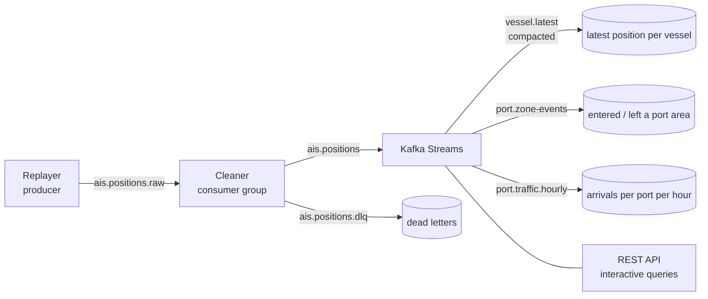

# AIS Stream Pipeline

Streams AIS position reports through Apache Kafka and turns them into live
vessel information: where every ship is now, which ships are entering or
leaving a port area, and how many arrive per hour.



- **Replayer:** plays position reports into Kafka at a chosen speed, keyed by
  MMSI so each vessel's reports stay in order. The reports come from a local
  AIS export or from built-in generated ships.
- **Cleaner:** a consumer group that turns AIS "not available" codes (speed
  102.3, heading 511 ...) into nulls. Reports it cannot use go to a dead-letter
  topic with the reason in a header.
- **Kafka Streams:** keeps each vessel's latest position in a state store and a
  compacted topic. It detects vessels entering and leaving port areas
  (Florø, Måløy, Ålesund) and counts arrivals per hour of AIS time.
- **REST API:** answers from the Kafka Streams state stores; there is no database.

The topics are the interface. Other services, such as the berth planner in
[ship-eta-berth-scheduler](https://github.com/Rohit-v-raj/ship-eta-berth-scheduler),
can subscribe to them without this one changing.

## Quick start (Windows, cmd)

You need Java 21 and Docker Desktop (running). Gradle is not needed: `gradlew.bat`
downloads it on first use.

```cmd
docker compose up -d
gradlew.bat bootRun
```

- Kafka UI (topics, partitions, consumer groups, lag): http://localhost:8088
- Pipeline API: http://localhost:8091

```cmd
curl -s http://localhost:8091/api/replay
curl -s http://localhost:8091/api/vessels
curl -s "http://localhost:8091/api/vessels?zone=Floro"
curl -s http://localhost:8091/api/ports/Floro/arrivals
```

Without an AIS export, the replayer generates 40 ships sailing between the
three ports.

### Replaying real AIS data

The replayer reads a CSV made from AIS parquet files (one file per day,
named `2020-2_group_N`) with `tools/export_ais.py`:

```cmd
..\port_ml_env\Scripts\python tools\export_ais.py --parquet-dir ..\ship-eta-berth-scheduler\data\parquets --files 5
gradlew.bat bootRun
```

The export goes to `data/`, which git ignores: AIS data is licensed and is
not part of this repository.

## API

| Call | What it does |
|---|---|
| `GET /api/replay` | Replay status: source, speed, records sent, acknowledged, failed, AIS time reached |
| `POST /api/replay/start`, `POST /api/replay/stop` | Start or stop the replay |
| `PUT /api/replay/speed?value=200` | Change the replay speed while it runs |
| `GET /api/vessels` | Number of vessels in the table, and the port areas |
| `GET /api/vessels/{mmsi}` | A vessel's latest position, and the port area it is in |
| `GET /api/vessels?zone=Floro` | Vessels now inside a port area |
| `GET /api/ports/{zone}/arrivals` | Arrivals per hour of AIS time |

## Running the stages separately

Each stage can be switched off, so stages (or several copies of one) run as
separate processes. For example, a second cleaner joins the consumer group
and takes half of the partitions:

```cmd
gradlew.bat build
java -jar build\libs\ais-stream-pipeline-0.0.1-SNAPSHOT.jar --server.port=8092 --pipeline.replayer.enabled=false --pipeline.streams.enabled=false
```

## The cluster

`docker-compose.yml` runs three Kafka 4.3 brokers in KRaft mode (no
ZooKeeper; each node is also a controller), plus the Kafka UI. Topics have
three replicas and `min.insync.replicas=2`, and producers use `acks=all`
with idempotence. The cluster keeps working with one broker down, and refuses
writes rather than risk losing them with two down.

| Topic | Partitions | Notes |
|---|---|---|
| `ais.positions.raw` | 6 | retention 1 day |
| `ais.positions` | 6 | retention 3 days |
| `ais.positions.dlq` | 1 | retention 7 days |
| `vessel.latest` | 6 | compacted |
| `port.zone-events` | 6 | |
| `port.traffic.hourly` | 3 | compacted |

## Tests

```cmd
gradlew.bat test
```

The topology is tested on `TopologyTestDriver` (no broker). An end-to-end test
runs the whole pipeline against a real broker with Testcontainers; it is
skipped when Docker is not running.

## Stack

Java 21 · Spring Boot 3.5 · Spring for Apache Kafka 3.3 · Kafka Streams 3.9 ·
Apache Kafka 4.3 (KRaft) in Docker · Kafka UI (kafbat) · Gradle

## Roadmap

See [PLAN.md](PLAN.md).
